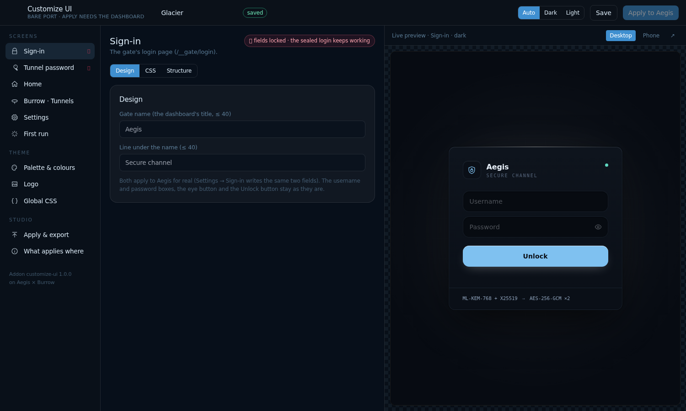
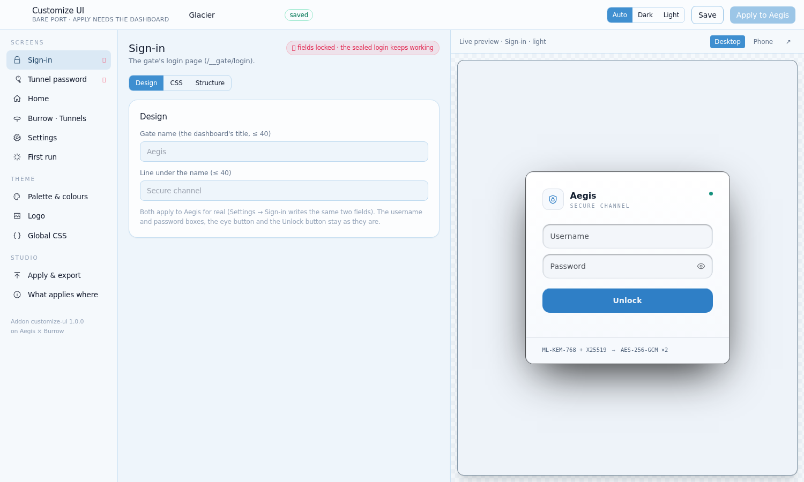

# Customize UI

A theme studio for your **Aegis × Burrow** dashboard. It opens from **Settings → Connected apps → Customize UI → Open** (or `/__gate/customize-ui/` on the dashboard) and, by default, **has no tile on the home page**. Inside: a menu per screen, cold colour palettes, a code editor for CSS, and a live preview of every screen in dark and light.

**Burrow only** (`"platforms": ["burrow"]`): it uses Burrow's extension API (SPEC.md §10) to mount itself under the dashboard's login, and from there the dashboard's own settings API to apply a theme.

## What you can change

| Menu | What | Applied to Aegis for real? |
|---|---|---|
| **Sign-in** | Gate name, the line under it, colours, CSS | Name and line: **yes** (`title`, `login.subtitle`). Colours/CSS: preview + theme pack |
| **Tunnel password** | Colours, CSS (an example tunnel name for the preview) | Preview + theme pack |
| **Home** | Greeting, tagline, 2 or 3 columns, background (grid, glow, plain), a home tile for the studio or not, colours, CSS | Greeting, tagline, columns, background, tile: **yes** (`home`). Colours/CSS: preview + theme pack |
| **Burrow · Tunnels**, **Settings**, **First run** | Colours, CSS | Preview + theme pack |
| **Palette & colours** | Four cold presets (Glacier, Steel, Deep sea, Arctic), every colour for dark and for light, corner radius, follow the system or always dark | Preview + theme pack |
| **Logo** | Your own .svg/.png/.webp/.jpg (square, ≤ 512 KB) | Kept in the addon's data, shown in previews, served at `/__gate/customize-ui/logo` for your link tiles |
| **Global CSS** | CSS shared by every screen | Preview + theme pack |
| **Apply & export** | Apply, download the theme pack (CSS) or the theme (JSON), import a JSON | |

**Honest limit.** Aegis × Burrow serves its sign-in, tunnel-password and home pages from its own files and has **no hook for an addon's stylesheet or logo yet**. So this addon applies everything Burrow's settings API accepts (the texts, the home layout and tiles), and turns the rest (colours, CSS, per screen, dark and light) into a **theme pack** you can keep, share, or put in front of the gate yourself. The studio says so on each screen rather than pretend.

**The fields stay.** On the sign-in and password screens the form, its inputs (`#username`, `#password`), the eye button, the Unlock button and `login.js` are **locked**: a theme styles around them and never removes them, because that is what seals the password in your browser (ML-KEM-768 + X25519 → AES-256-GCM). The Structure tab shows the real markup with the locked lines marked.

<p align="center"> </p>

## Look

Helvetica Medium only (weight 500 everywhere but the code editor), Tailwind following your system's dark or light mode, cold ice-blue palette. The code editor is Ace, styled as glass. Both load from their CDNs (Tailwind Play CDN, cdnjs), so the studio page needs the browser to be online; the addon's server and your themes don't.

## Settings

| Key | Type | Default | Meaning |
|---|---|---|---|
| `PORT` | number | 8797 | Where the studio listens on this machine (same address as its host). You open it through the dashboard |
| `HOME_TILE` | bool | off | Off: reachable from Settings → Connected apps only. On: also a tile on the home page. The studio's Home menu has the same switch |
| `PRESET` | select | glacier | The palette a fresh theme starts from |

## Actions

- **Restart**: restarts the studio.
- **Reset theme** (asks first): every screen back to the default look and the logo removed from the addon. What you already applied to Aegis stays until you apply again.

## What install changes on the machine

- Runs `app/server.py` as a systemd user service (`weft-customize-ui-….service`) or, without systemd, as a background process. Data in `ADDON_DATA`: `config.json`, `theme.json`, `logo.<ext>`, and `key`.
- `key` is a random secret, mode 600. Burrow's mount (`burrow/extension.mjs`) sends it with every request, so the studio is only reachable through the dashboard's login. The bare port answers `/health` and a page that says so.
- Writes **one** file outside: `~/.config/aegis/integrations/customize-ui.json`. That is what lists the studio under **Settings → Connected apps** with an Open button (SPEC.md §9 is the host dropping files for an addon; this is the addon plugging into the dashboard, the way Selkies Forge does). Uninstall removes it.
- On the dashboard, when you first open the studio: unless `HOME_TILE` is on, it hides its own two home tiles (`addon:customize-ui`, `app:customize-ui`) through `POST /__gate/api/prefs`; nothing else on your home page is touched. When you press **Apply to Aegis** it writes the gate name, sign-in line and home fields listed above.
- Its entry on the Weft mesh (`provides: ["themes"]`), removed when it stops.

Uninstall stops the service, removes the unit, the mesh entry and the Connected apps file. The host deletes the data folder if you ask it to.

## Try it

```
node tools/weft-check.mjs customize-ui --publish
node tools/weft-run.mjs customize-ui install --host burrow
node tools/weft-run.mjs customize-ui status --host burrow
```

Then add the folder (or this repository's link) on the Burrow page's Addons section and open it from Settings → Connected apps.

`app/screens/login.html`, `unlock.html` and `login.css` are copies from Aegis × Burrow, used for the previews, under its MIT licence (`app/screens/LICENSE-aegis-burrow`). `weft/lib.sh` and `weft/mesh.py` are identical copies of the Weft Architecture's `tools/`.

## Credits

Powered by the [Weft Architecture](https://github.com/alexd-aero/weft). Runs on [Selkies Forge](https://github.com/adatskov-wcpss/animated-fiesta) and [Aegis × Burrow](https://github.com/alexd-aero/aegis-burrow).

Customize UI is MIT licensed. The screens it previews are Aegis × Burrow's, MIT, copyright Alexd Aero.
